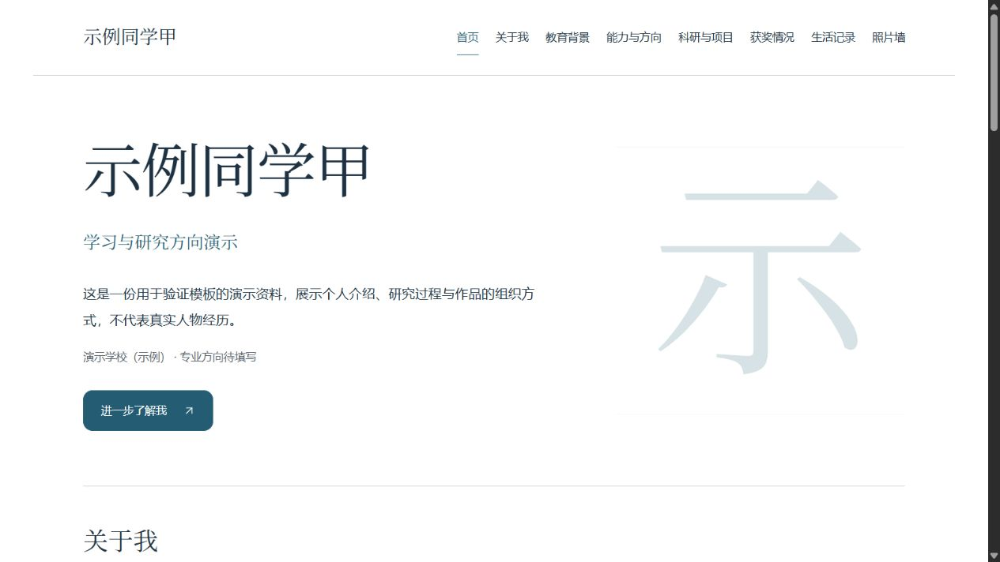
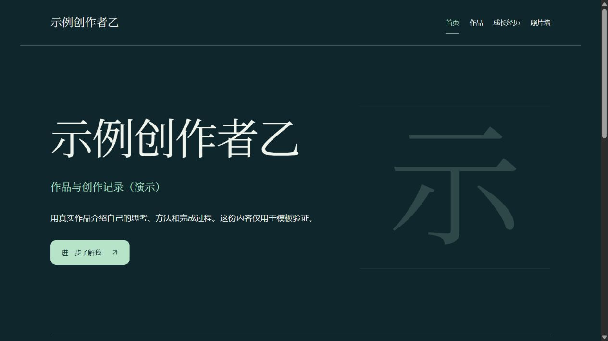

# Personal Intro Site · 个人介绍网站 Skill

把姓名、个人资料和想要的栏目交给 Agent，生成一个可以运行、继续维护的个人网站。

这个仓库提供 `personal-intro-site` Skill，适合个人介绍、简历展示、学术主页、作品集和生活记录。希望网站不仅好看，也能在应聘、申请项目组或介绍自己时，清楚地展示经历、能力和真实成果。

## 能做什么

- 按需要组合：关于我、教育背景、能力与技能、科研项目、获奖情况、作品、经历、生活记录、照片墙、联系方式和自定义栏目。
- 支持首页分区、独立栏目页、长文详情页和照片放大浏览。
- 提供 editorial、academic、studio、warm 四套基础主题，并由 Agent 按个人用途继续调整。
- 将内容与页面代码分开，便于更换介绍、增加项目、撰写记录和替换照片。
- 附带照片和条目导入工具：导入文件时同时更新引用，减少“照片传了却不显示”的问题。
- 生成面向 AI 的维护说明，以及面向新手的网站使用指南。
- 未提供的信息保留待填写，不编造学校、奖项、科研成果或联系方式；示例资料和 AI 图片有明确标识。

这是 **Skill 和建站基础模板**。安装后由 Agent 执行建站工作；并不是打开本仓库就能在线填写资料的网页应用。

## 效果示例

以下使用演示资料，不代表真实人物经历。基础主题用于确定起点，具体网站仍应结合个人资料进行设计。

**学术 / 个人介绍**



**作品展示**



## 安装到 Codex

将下面这句话发给支持 skill-installer 的 Codex：

```text
请使用 skill-installer 安装这个 Skill：
https://github.com/lhyyayay/web_create_skill/tree/main/personal-intro-site
```

安装的是仓库内的 **personal-intro-site 文件夹**，不是整个仓库根目录。安装完成后，在下一轮对话中调用；如果客户端尚未显示，重新打开会话再检查。

也可以在 GitHub 点击 **Code → Download ZIP**，解压后将完整的 `personal-intro-site` 文件夹放入自己的 Skills 目录。Codex 默认位置为 `~/.codex/skills/`；设置了 `CODEX_HOME` 时使用其下的 `skills/`。

其他 Agent 需要具备读取 `SKILL.md`、编辑文件和运行项目的能力，按相应产品的 Skill 加载方式安装。普通聊天窗口若没有文件操作或仓库权限，只能提供修改建议，不能直接完成建站或提交代码。

## 怎样使用

安装后，可以直接这样说，不必自己写配置文件：

```text
使用 $personal-intro-site 创建个人网站。

姓名：张同学
个人信息：我正在学习环境科学，对数据分析和生态研究感兴趣。
需要栏目：关于我、教育背景、能力与技能、科研项目、获奖情况、生活记录、照片墙。
主要用途：申请项目组、应聘时介绍自己，也记录日常生活。
风格偏好：清爽、安静，适合认真阅读。
未提供的信息保留待填写，先生成可以运行的预览。
```

最少只需提供姓名、已有资料和栏目。用途、风格、照片、简历等材料可以随后补充。Agent 应根据实际需求完善页面，而不是要求每个人使用同样的画面。

已有网站也可以交给它继续维护；应先检查原项目，保留适用的框架和内容结构。

## 不通过 Agent：运行示例

需要 Node.js 和 npm。模板声明 Node.js **22.18.0 及以上**；本次验证使用 **24.22.1**。首次安装依赖需要网络。

在下载或克隆的本仓库根目录运行：

```sh
node personal-intro-site/scripts/create-site.mjs --brief examples/academic.json --out output/my-site
cd output/my-site
npm ci
npm run dev
```

打开终端显示的本地网址即可预览。`output/my-site` 必须是尚不存在的目录，生成器不会覆盖已有文件。安装依赖和预览命令在**生成的网站目录**中执行，仓库根目录本身不是 Vite 应用。

仓库提供三份输入示例：

| 文件 | 用途 |
| --- | --- |
| [academic.json](examples/academic.json) | 学术介绍、科研项目、生活记录与照片墙 |
| [creative.json](examples/creative.json) | 作品集、独立作品页与经历 |
| [minimal.json](examples/minimal.json) | 只有姓名、少量资料与自定义栏目 |

也可以自己写一份 UTF-8 JSON：

```json
{
  "name": "张同学",
  "info": {
    "title": "环境科学学习者",
    "bio": "对数据分析和生态研究感兴趣。",
    "school": "",
    "major": ""
  },
  "sections": ["关于我", "教育背景", "能力与技能", "科研项目", "获奖情况", "照片墙"]
}
```

准确字段和可选设置见 [内容结构说明](personal-intro-site/references/brief-and-content.md)。

## 生成后，在哪里改内容

以下路径都相对于**生成的网站目录**：

| 位置 | 内容 |
| --- | --- |
| `content/site.json` | 姓名、个人介绍、栏目、项目、奖项、记录和图片引用 |
| `content/entries/` | 条目的 Markdown 长文正文 |
| `public/media/` | 网站使用的图片 |
| `public/attachments/` | 简历、作品说明等需要公开的附件 |
| `src/styles.css` | 主题、字体、间距和响应式样式 |
| `README.md` | 生成的网站用途和实际栏目介绍 |
| `给AI的网站维护说明.txt` | 发给有文件操作能力的 AI，指导其修改内容 |
| `网站使用指南.txt` | 给网站主人阅读的新手说明 |

“关于我”主要使用 `profile` 中的姓名、标题、简介、学校、专业、地点、照片和链接。教育、能力、项目、获奖、作品与经历等内容放在对应栏目 `items` 中。

已有条目保留原 `id`，修改其字段及 `bodyFile` 引用的正文即可。新增条目使用不同的稳定 ID。`enabled: false` 可以隐藏栏目或条目；栏目 `empty: "hide"` 可隐藏没有内容的栏目。隐藏不等于私密存储。

栏目 `layout: "section"` 显示在首页内，`layout: "page"` 使用独立页。模板使用 hash 路由，支持栏目页和条目详情。

### 上传照片，并更新清单

在生成的网站目录先完成 `npm ci`，然后按用途选择：

```sh
# 照片墙
npm run photo:add -- --file "<照片绝对路径>" --section gallery --caption "这一天的记录"

# 个人照片
npm run photo:add -- --file "<个人照片绝对路径>" --target portrait --alt "个人照片"

# 某篇生活记录的封面
npm run photo:add -- --file "<封面绝对路径>" --target cover --section journal --entry first-note
```

请将尖括号内容替换为实际路径。`gallery`、`journal` 和 `first-note` 必须对应自己配置中已有的栏目或条目 ID。

工具支持 JPEG、PNG、WebP，读取实际尺寸，将图片复制到网站内，并更新内容引用；原照片保留。AI 生成图需加 `--ai true`。工具不会自动压缩图片，也不会自动发布；大图建议先合理压缩。

如果直接通过 GitHub 网页上传，需要同时修改 `content/site.json` 中的图片路径、实际宽高、替代文字和 `isAI` 标记，只上传文件不会自动出现在页面上。详细操作可交给具备仓库写权限的 Agent。

### 增加项目或生活记录

准备条目 JSON，可参考 [project-entry.json](examples/project-entry.json)。至少需要 `id` 与 `title`，还可填写摘要、个人角色、贡献、方法、成果和正文。

```sh
npm run entry:add -- --section projects --input "<条目JSON绝对路径>"
```

长文也可以单独提供 Markdown 文件：

```sh
npm run entry:add -- --section journal --input "<记录JSON绝对路径>" --body "<正文Markdown绝对路径>"
```

工具建立正文关联，拒绝覆盖已有 ID。科研和求职项目建议写清楚：要解决什么问题、自己负责什么、实际做了什么、使用什么方法、取得什么可核实的结果。不要将整个团队的成绩全部写成个人成果。

更多维护规则见 [维护说明](personal-intro-site/references/maintenance.md)。

## 检查与发布

在生成的网站目录运行：

```sh
npm run check:content
npm test
npm run build
npm run preview
```

构建产物为 `dist/`。部署目标、仓库、分支与账号应由使用者指定，Skill 不会自动创建账号、邀请协作者或修改域名。

可以部署到支持静态资源的网站托管服务。若希望“推送 GitHub 后 Cloudflare 自动更新”，需要另外完成 Git 连接、生产分支、构建与部署配置。**代码检查通过、托管平台发布成功、线上页面可访问，是三件分别需要确认的事。**

[部署说明](personal-intro-site/references/deployment.md) 提供发布时的核对方向。默认模板不包含在线编辑后台、账号登录、上传服务器、私密存储或服务器永久删除功能；需要这些能力时应另行实现。

## 仓库结构

```text
web_create_skill/
├── README.md
├── personal-intro-site/       # 实际安装的 Skill
│   ├── SKILL.md              # Agent 工作入口
│   ├── agents/openai.yaml    # Codex 展示信息
│   ├── scripts/              # 生成器与行为测试
│   ├── references/           # 内容、设计、维护和部署说明
│   └── assets/starter/       # 可运行的 Vue 网站模板
├── examples/                 # 输入资料与新增条目示例
└── docs/
    ├── images/               # 演示截图
    └── validation.md         # 验证范围与结果
```

模板使用 Vue、Vite、Vue Router、Markdown-it、DOMPurify、Lucide 和 PhotoSwipe，附带依赖锁文件。模板依赖各自遵循上游许可。

## 已验证范围

2026-10-30 已完成 Skill 官方格式检查、5 项生成/维护行为测试，以及三个示例场景的内容检查、项目测试和生产构建。另对代表性的桌面与手机页面进行了实际浏览检查，包括导航、详情页、菜单、照片放大和关闭后焦点恢复。

详细结果与限制见 [验证记录](docs/validation.md)。这不代表已经覆盖所有浏览器、尺寸或未来定制功能。

开发者可在仓库根目录运行行为测试，`--project` 指向已执行 `npm ci` 的生成网站：

```sh
node personal-intro-site/scripts/test-skill.mjs --project output/my-site --workdir output/skill-tests
```
